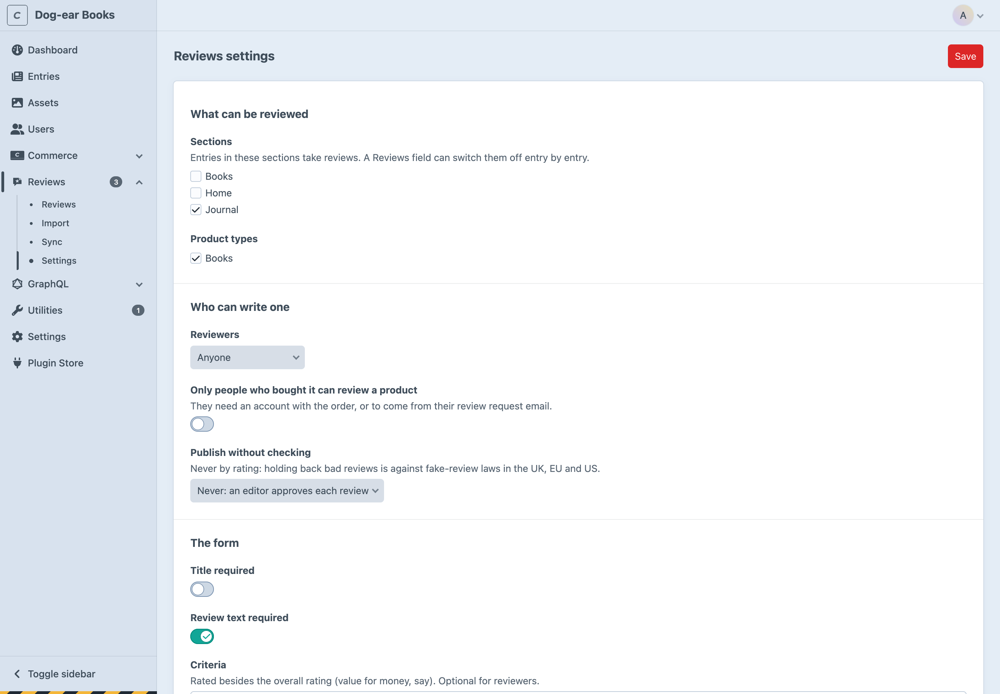

# Installation

## Requirements

- Craft CMS 5.6 or later, PHP 8.2 or later.
- PHP's GD extension, for [photos](photos.md) (optional).
- Craft Commerce 5, for [verified buyers and review requests](commerce.md) (optional).

## Installing

```bash
composer require 1994/reviews-craft
php craft plugin/install reviews
```

Or search for Reviews in the Plugin Store.

## The first settings

Open **Reviews → Settings**:




1. Under **What can be reviewed**, tick the sections whose entries take reviews, and with Commerce, the product types.
2. Choose who can write reviews, and whether they're published straight away (by default, an editor approves each one).
3. Save.

Then add the reviews to the entry or product template:

```twig
{# In your layout's <head> #}
{{ craft.reviews.styles() }}

{# Where the reviews go #}
{{ craft.reviews.display(entry) }}
```

That's the average, the reviews and the form: see [Ready-made reviews](ready-made.md). To write your own markup instead, see [Templates](templates.md).

## Permissions

Admins can do everything. For other users, under **Reviews** in their permissions:

| Permission | |
| --- | --- |
| Moderate and reply to reviews | The reviews screen: approve, reject, mark as spam, reply, add notes. |
| Delete reviews | |
| Import and sync reviews | The Import and Sync screens. |

The settings are in Project Config, so they change only where admin changes are allowed.

## Updating

```bash
composer update 1994/reviews-craft
php craft up
```

See the [changelog](../CHANGELOG.md) for what's changed.
