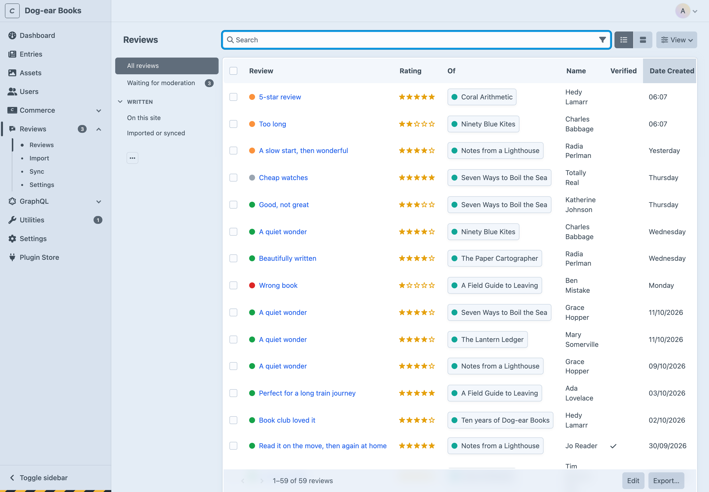
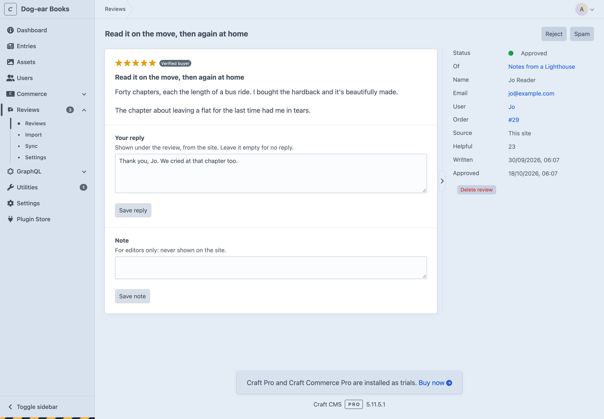

# Moderation

## The reviews screen

**Reviews** in the control panel lists every review. The sources down the side show what's **waiting for moderation** (with a count, also on the nav item), reviews **written on this site**, and ones **imported or synced**. The status menu, search, sorting and columns work as on any Craft index. Select reviews to **approve**, **reject**, **mark as spam** or **delete** them together.

Open a review to see everything it says: the rating, the criteria, photos (including ones waiting, which only editors can see), who wrote it, and where it came from.

- **Approve**, **Reject** or **Spam** at the top.
- **Your reply** is shown under the review on the site, from the site. Leave it empty to take the reply off.
- **Note** is for editors only: why it was rejected, say. Never shown on the site.

What a reviewer wrote can't be changed: see [Fair reviews](privacy.md#fair-reviews). When a reviewer changes their review, it waits for an editor again (unless it'd be published straight away anyway).

## Publishing without checking

By default, an editor approves every review. Under **Settings → Publish without checking**, reviews by signed-in users, or by [verified buyers](commerce.md), can go up straight away. Never by rating.

## Emails

| | Setting | System message |
| --- | --- | --- |
| A review has been written | **Tell these people about new reviews** | When a review is written |
| A reviewer's review is up | **Email reviewers when their review goes up** | When a reviewer's review goes up |
| The site replied | **Email reviewers when you reply** | When the site replies to a review |
| Asking for a review | [Commerce](commerce.md#review-request-emails) | When a customer is asked to review their order |

Change their wording under **Utilities → System Messages**. Reviewers are only emailed about reviews they wrote on this site.

## The dashboard widget

**Reviews waiting** lists the oldest reviews waiting for an editor. Add it from the dashboard's **New widget** menu.

## The Reviews field

Optional. Add a **Reviews** field to an entry type or product type to:

- switch reviews off for one entry, in a section that otherwise takes them;
- show its average and how many reviews it has, in the editor;
- use `entry.reviews.average`, `entry.reviews.count` and `entry.reviews.reviews.all()` in templates.

In an element index, its column shows the average and count.
