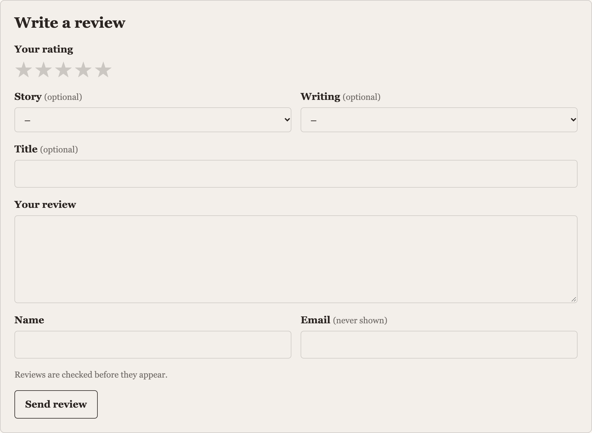

# Templates

Everything the [ready-made section](ready-made.md) does, you can do yourself with `craft.reviews`.

## Reviews

`craft.reviews.reviews(element)` is a query for an element's **approved** reviews, newest first, like any Craft element query:

```twig



    <article id="review-{{ review.id }}">
        <p>{{ review.rating }} out of 5</p>
        <h3>{{ review.title }}</h3>
        <p>{{ review.body|nl2br }}</p>
        <p>{{ review.displayName }}, {{ review.dateCreated|date('long') }}, verified buyer</p>
        <blockquote>{{ review.reply|nl2br }}</blockquote>
    </article>

```

Query parameters, besides Craft's own (`limit`, `offset`, `orderBy`, `search` and so on):

| Parameter | |
| --- | --- |
| `rating(5)`, `rating([4, 5])`, `rating('>= 4')` | Only these ratings. |
| `verified()` | Only verified buyers' (with [Commerce](commerce.md)). |
| `withPhotos()` | Only reviews with photos. |
| `counted()` | Only reviews that count towards the average: this site's own, and imports you count as your own. |
| `source(':empty:')`, `source('trustpilot')` | Only reviews written here, or from one platform. |
| `userId(id)`, `email(address)` | One person's. |
| `reviewSiteId(id)` | Written on one site. With [separate sites](configuration.md#multi-site), the current site's is the default. |
| `status('pending')` | Reviews that aren't approved. `status(null)` for every status. Only for editors' pages: never show unapproved reviews to visitors. |

`orderBy` takes `rating`, `helpful`, `dateCreated` and `dateApproved`. Without `element`, `craft.reviews.reviews()` finds reviews of anything: `craft.reviews.reviews().rating(5).limit(3).all()` for the latest five-star reviews on the site.

A review has:

| | |
| --- | --- |
| `rating` | 1 to 5. |
| `ratings` | The criteria's ratings, by handle: `review.ratings.story`. |
| `title`, `body` | As written. Escape them as Twig does by default. |
| `displayName` | The name, as the settings show names ("Jo B."). `name` is the name as given. |
| `stars` | Five stars to draw: each has `type` (`full`, `half` or `empty`). `getStars('story')` for a criterion's. |
| `verified` | Bought it, with Commerce. |
| `reply`, `dateReplied`, `replyBy` | The site's reply. |
| `helpful` | How many found it helpful. |
| `publicPhotos` | Photos on show: each has `url`, `alt` and `asset` (or null for an imported photo). |
| `element` | The entry or product reviewed. |
| `source`, `sourceUrl`, `isOwn` | Where it came from: `null` and `true` for this site's own. |
| `dateCreated`, `dateApproved` | |

## The numbers

```twig



    {{ summary.rounded }} out of 5, from {{ summary.count }} reviews

```

| | |
| --- | --- |
| `count` | How many approved reviews count towards the average. |
| `average`, `rounded` | The average, exact and to one decimal place. Null with no reviews. |
| `percent` | The average out of 100. |
| `breakdown` | 5 to 1: each has `rating`, `total` and `percent`. |
| `criterionAverage('story')` | A criterion's average. |

`craft.reviews.stars(4.5)` gives five stars to draw for any number. With a [Reviews field](moderation.md#the-reviews-field), `entry.reviews.average` and `entry.reviews.count` work too.

## Writing your own form




Post to the `reviews/reviews/submit` action. `craft.reviews.formFields(element)` adds the action, the CSRF token, the element, the [spam checks](spam.md) and the captcha:

```twig



    <p>{{ options.refusalMessage }}</p>

    <form method="post" enctype="multipart/form-data">
        {{ craft.reviews.formFields(entry) }}
        {{ redirectInput(entry.url ~ '#reviews') }}

        
            <label><input type="radio" name="rating" value="{{ value }}" {{ options.old.rating == value ? 'checked' }} required> {{ value }}</label>
        

        <input name="title" value="{{ options.old.title }}">
        <textarea name="body">{{ options.old.body }}</textarea>

        
            <input name="name" value="{{ options.old.name }}" required>
            <input type="email" name="email" value="{{ options.old.email }}" required>
        

        <p>{{ message }}</p>

        <button>Send</button>
    </form>

```

| Field | |
| --- | --- |
| `rating` | Required: 1 to 5. |
| `ratings[handle]` | A criterion's rating. Optional. |
| `title`, `body` | Required or not, as the settings say. |
| `name`, `email` | Required for guests. Signed-in reviewers are shown by their account's name. |
| `photos[]` | Files, when [photos](photos.md) are on. |
| `removePhotos[]` | When changing a review: the indexes of photos to take off. |

`formOptions` also has `criteria`, `titleRequired`, `bodyRequired`, the limits (`titleLimit`, `bodyLimit`, `nameLimit`), `photosEnabled`, `maxPhotos`, `existingPhotos`, `moderated` (whether reviews are checked first), and `editing` and `review` for a signed-in reviewer changing theirs.

When something's wrong, the form's page is shown again with `reviewForm` holding what was sent and its errors. When it's sent, the visitor goes to the `redirect` with a message in the `reviews` flash:

```twig

<p>{{ notice }}</p>
```

### With JavaScript

Send the form with `Accept: application/json` to get `{"success": true, "message": "…"}`, or `{"success": false, "errors": {"field": ["…"]}}` with a 400. A guest always gets the same success message, whether their review was new or a repeat: the form never tells anyone whether an email address has reviewed something.

## "Helpful" and deleting

```twig
<form method="post">
    {{ actionInput('reviews/reviews/vote') }}
    {{ csrfInput() }}
    {{ hiddenInput('reviewId', review.id) }}
    <button>Helpful ({{ review.helpful }})</button>
</form>
```

One vote per person: by account, or for guests, a cookie. A signed-in reviewer can delete their own review the same way, with `reviews/reviews/delete`.

## Can they review it?

`craft.reviews.canReview(entry)` is true when the visitor can review it. `craft.reviews.refusal(entry)` says why not: `unavailable` (the entry doesn't take reviews), `sign_in` or `buyers_only`. `craft.reviews.mine(entry)` is the signed-in visitor's own review, if any.
